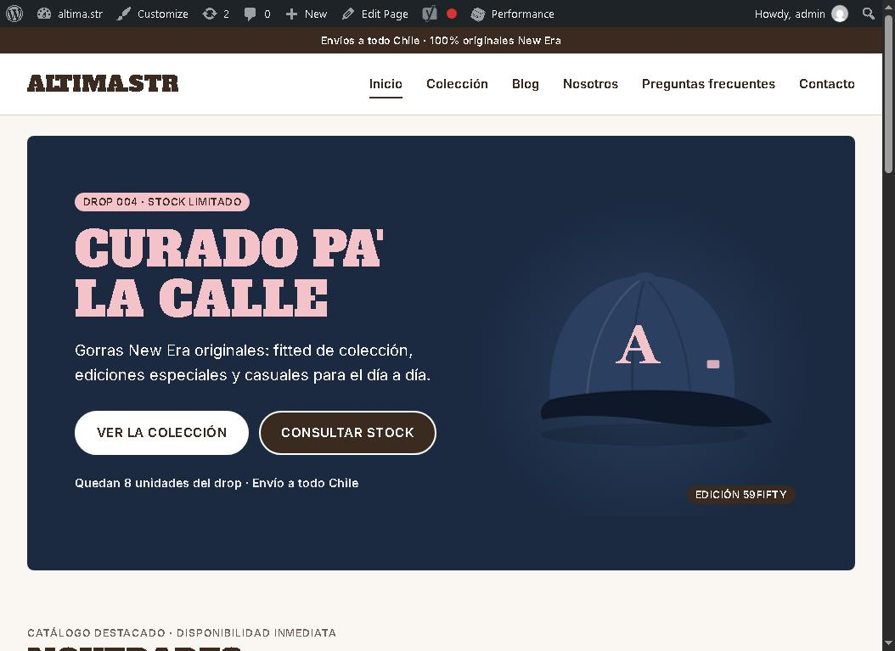

# altima.str · Sitio WordPress

Tienda de gorras New Era originales para la comunidad streetwear en Chile, llevada a WordPress con un tema propio.

**Sitio en producción:** [https://altimastr.free.nf](https://altimastr.free.nf)
**Prototipo en Stitch:** [Altima Streetwear E-Commerce Store](https://stitch.google.com/projects/15004287554006970478)
**Repo del Parcial 02:** [masturjrr1/mi-emprendimiento](https://github.com/masturjrr1/mi-emprendimiento)
**Autor:** Ignacio Galindo · Sitios Web y Landing Pages (MKA1203), Duoc UC

## Contexto de la web

altima.str vende gorras New Era originales: fitted 59FIFTY de colección, ediciones especiales y modelos casuales 9FORTY. Su cliente es Carlos, 25 años, que descubre gorras en Instagram y TikTok, compra desde el celular y necesita estar seguro de que la gorra es original y de qué talla pedir. El sitio resuelve esas dudas antes de la compra: muestra la colección con precio, talla y stock, explica autenticidad, tallas y envíos, y publica guías en el blog. Cuando Carlos llega, queremos que encuentre su gorra y **la consulte** (formulario de contacto o WhatsApp); la compra con carro queda para la etapa 2.

## Mi tema

**Tema propio:** `altima-str` (versión 1.1), construido desde `tema-base/` con los colores, tipografías y componentes de `DESIGN.md` y del prototipo de Stitch.

- Código del tema: [`proyecto/mi-tema/`](proyecto/mi-tema/)
- Tema listo para instalar: [`proyecto/altima-str.zip`](proyecto/altima-str.zip)

| Archivo | Qué hace |
|---|---|
| `style.css` | Variables de DESIGN.md (café, azul marino, rosa, hueso; Alfa Slab One e Inter) y todos los estilos, incluido el responsive. |
| `functions.php` | Sin cambios respecto de `tema-base/`: menú, imagen destacada, `title-tag` y carga del CSS. |
| `header.php` | Franja de envíos, logo ALTIMA.STR, menú principal con hamburguesa en celular (sin JavaScript) y carga de las fuentes. |
| `footer.php` | Sellos de confianza, columnas Tienda, Ayuda y altima.str, redes y frase "Pa' usar o pa' guardar." |
| `front-page.php` | Home: hero del Drop 004, novedades, texto de la página Inicio, últimas entradas y bloque de novedades. |
| `index.php` / `archive.php` | Blog y categorías en grilla de tarjetas 16:9. |
| `single.php` | Entrada con cabecera azul marino, tiempo de lectura, llamada a consultar stock y navegación. |
| `page.php` | Páginas (Colección, Nosotros, Preguntas frecuentes, Contacto). |
| `assets/img/` | Fotos de las 8 gorras en WebP (600 × 600 px, entre 5 y 14 KB cada una) e ilustración de respaldo para las entradas sin imagen. |

### Instrucciones para instalar mi tema en un WordPress limpio

1. **Descarga el tema:** baja [`proyecto/altima-str.zip`](proyecto/altima-str.zip) desde este repo (botón *Download raw file*). Si cambiaste el tema, genera un zip nuevo desde la raíz del repo con:
   `git archive --format=zip --prefix=altima-str/ -o proyecto/altima-str.zip HEAD:proyecto/mi-tema`
2. **Instálalo:** en WordPress, **Apariencia > Temas > Añadir nuevo tema > Subir tema**, elige el `.zip` y pulsa **Instalar ahora**. Si el tema ya existe, elige **Reemplazar lo instalado con lo subido**.
3. **Actívalo:** pulsa **Activar**.
4. **Crea las páginas** (ver la tabla "Páginas y entradas" más abajo). Los *slugs* importan, porque el footer enlaza a ellos: `inicio`, `coleccion`, `blog`, `nosotros`, `preguntas-frecuentes` y `contacto`.
5. **Configura la portada:** **Ajustes > Lectura > Una página estática**: Portada = *Inicio*, Página de entradas = *Blog*.
6. **Crea el menú:** **Apariencia > Menús**, agrega Inicio, Colección, Blog, Nosotros, Preguntas frecuentes y Contacto, y asígnalo a **Menú principal**.
7. **Enlaces permanentes:** **Ajustes > Enlaces permanentes > Día y nombre** (o *Nombre de la entrada*) y guarda.
8. **Instala los plugins** de la tabla de abajo y configura Contact Form 7 y WP Mail SMTP como se explica en "Formulario de contacto".
9. **Idioma y zona horaria:** **Ajustes > Generales**: Español de Chile y America/Santiago.

**Qué debe tener el servidor:** probado con **WordPress 7.1.5**, **PHP 8.4.28** y **MariaDB 11.4**. El tema pide como mínimo WordPress 6.4 y PHP 7.4, pero **Contact Form 7 6.2 exige WordPress 7.1 o superior**.

## Plugins instalados

| Plugin | Para qué lo uso | Gratis o de pago | Versión |
|---|---|---|---|
| Yoast SEO | Títulos y meta descripciones de cada página y entrada, sitemap XML | Gratis (tiene Premium) | 28.9 |
| Contact Form 7 | Formulario de contacto (nombre, correo, asunto y mensaje) en la página Contacto | Gratis | 6.2.6 |
| WP Mail SMTP | Envía los correos del formulario por Gmail (`smtp.gmail.com`), porque InfinityFree no envía correos con PHP | Gratis (tiene Pro) | 4.10.5 |
| Flamingo | Guarda en el panel cada mensaje recibido por el formulario (respaldo si el correo falla) | Gratis | 2.6.4 |
| AddToAny Share Buttons | Botones para compartir las entradas del blog (WhatsApp, Facebook, X y correo) | Gratis | 1.8.18 |
| Joinchat | Botón flotante de WhatsApp para consultas de stock y tallas | Gratis (tiene Premium) | 6.4.4 |
| BackWPup | Respaldo de archivos y base de datos (listo para el hosting de la etapa 2; en InfinityFree no se ejecuta, ver "Respaldo") | Gratis (tiene Pro) | 5.7.8 |
| Akismet | Protección contra spam en comentarios (instalado, inactivo: los comentarios están cerrados) | Gratis para sitios personales | 5.7.2 |
| W3 Total Cache, Loginizer | Vienen con la instalación de Softaculous en InfinityFree: caché y protección contra intentos de acceso | Gratis | 2.11.0 / 2.1.2 |

## Páginas y entradas

**Páginas:** Inicio (portada), Colección, Blog (página de entradas), Nosotros, Preguntas frecuentes y Contacto.

**Entradas del blog:**

1. *Guía de tallas New Era: cómo elegir tu 59FIFTY sin equivocarte* (categoría Guías)
2. *59FIFTY, 9FORTY y 9FIFTY: ¿qué gorra New Era es para ti?* (categoría Cultura)
3. *Cómo cuidar y guardar tus gorras de colección* (categoría Cuidado)

## Formulario de contacto

- Está en **Contacto** con los campos Nombre, Correo, Asunto y Mensaje. Al enviar muestra: "¡Gracias! Recibimos tu mensaje y te respondemos en menos de 24 horas."
- Los mensajes llegan a **nachogalindo.puntok@gmail.com** y quedan guardados en **Flamingo > Mensajes entrantes**.
- **Configuración de correo (WP Mail SMTP):** Mailer *Otro SMTP*, host `smtp.gmail.com`, cifrado TLS, puerto 587, autenticación activada, usuario = la cuenta de Gmail, contraseña = una **contraseña de aplicación de Google** (se crea en *Cuenta de Google > Seguridad > Verificación en dos pasos > Contraseñas de aplicaciones*). La contraseña se escribe solo en el panel de WordPress: **nunca en este repositorio**.
- Para probar: **WP Mail SMTP > Herramientas > Prueba de correo**, y después un mensaje real desde la página Contacto.

## Respaldo y reinstalación en otro servidor

El objetivo es poder respaldar el sitio y reinstalarlo en cualquier servidor. Se respaldan dos cosas:

- **Los archivos de WordPress:** `wp-content/themes/altima-str`, `wp-content/plugins` y `wp-content/uploads`.
- **La base de datos:** páginas, entradas, menús, formularios y configuración.

### Cómo respaldo mi sitio

**En InfinityFree (hosting actual) respaldo a mano, en dos partes**, porque el plan gratis bloquea las tareas en segundo plano que usan los plugins de respaldo:

1. **Base de datos:** panel de InfinityFree > **MySQL Databases** > **phpMyAdmin** junto a la base de datos del sitio > pestaña **Exportar** > método *Rápido*, formato *SQL* > **Exportar**. Se descarga un archivo `.sql`.
2. **Archivos:** panel de InfinityFree > **File Manager** > carpeta `htdocs/wp-content/`: descargo `themes/altima-str`, `plugins` y `uploads` (o los bajo por FTP con FileZilla, con los datos de **FTP Details**).
3. **Dónde queda:** guardo el `.sql` y las carpetas en una carpeta con la fecha (por ejemplo `respaldo-altima-2026-11-24`) en Google Drive y en mi computador, **fuera del servidor**.
4. **Cada cuánto:** una vez al mes y antes de cada cambio grande (actualizar WordPress, instalar un plugin nuevo o cambiar el tema).

**En un hosting con cPanel normal (etapa 2):** uso **BackWPup** (ya instalado). En **BackWPup > Hacer una copia de seguridad ahora > Iniciar** genera un `.zip` con los archivos y el `.sql`; el trabajo "First backup" quedó programado **una vez al mes**. El archivo queda en `wp-content/uploads/backwpup/…/backups/` y se descarga desde **BackWPup > Copias de seguridad**.

**El tema** además está versionado en este repo, así que siempre se puede reinstalar desde `proyecto/altima-str.zip`.

### Cómo lo reinstalo en un servidor nuevo

1. **Requisitos del servidor:** PHP 8.3 o superior, MySQL 8 o MariaDB 10.6 o superior, WordPress 7.1 o superior, al menos 500 MB libres (hoy el sitio ocupa bastante menos), HTTPS y, de preferencia, SMTP propio.
2. **Instalar WordPress limpio:** con el instalador del hosting (Softaculous o similar) o subiendo WordPress por FTP y creando una base de datos vacía en el panel.
3. **Restaurar el respaldo:**
   - **Archivos:** descomprime el `.zip` de BackWPup y sube por FTP (FileZilla) las carpetas `wp-content/themes/altima-str`, `wp-content/plugins` y `wp-content/uploads` al `wp-content/` del servidor nuevo.
   - **Base de datos:** en phpMyAdmin del servidor nuevo, selecciona la base de datos de WordPress e **Importa** el archivo `.sql` del respaldo.
   - Si el prefijo de las tablas no es `wp_`, ajusta `$table_prefix` en `wp-config.php` para que coincida con el respaldo.
4. **Ajustar:**
   - **URL del sitio:** si cambia el dominio, actualiza `siteurl` y `home` en la tabla `wp_options` (phpMyAdmin) y reemplaza la URL antigua en el contenido con un plugin como *Better Search Replace* (busca `https://altimastr.free.nf` y reemplaza por la URL nueva).
   - **Enlaces permanentes:** entra a **Ajustes > Enlaces permanentes** y pulsa **Guardar** para regenerar el `.htaccess`.
   - **Menú y portada:** revisa **Apariencia > Menús** (ubicación *Menú principal*) y **Ajustes > Lectura** (Inicio y Blog).
   - **Correo:** vuelve a escribir la contraseña de aplicación en WP Mail SMTP (o usa el SMTP del hosting nuevo).
5. **Probar:** que abran la portada y las 6 páginas sin errores; que se vean las fotos de las gorras y las fuentes; que el menú funcione en celular; que las 3 entradas aparezcan en el Blog; y enviar un **mensaje de prueba** desde Contacto, confirmando que aparece el aviso de "¡Gracias!", que llega al correo y que queda en Flamingo.

**Si solo quieres instalar el tema** en un WordPress nuevo y crear el contenido desde cero, sigue "Instrucciones para instalar mi tema" más arriba.

### Problemas que tuve y cómo los resolví

- **Contact Form 7 no se instalaba** ("La instalación del paquete falló"): el WordPress que instaló Softaculous era 7.0.2 y CF7 6.2 pide una versión más nueva. Actualicé WordPress a 7.1.5 desde **Escritorio > Actualizaciones** y se instaló sin problemas.
- **InfinityFree no envía correos con PHP:** configuré WP Mail SMTP con Gmail y agregué Flamingo para no perder mensajes.
- **El formulario seguía mostrándose en inglés después de editarlo:** era la caché de W3 Total Cache. Se soluciona con **Rendimiento > Vaciar todas las cachés** después de cada cambio.
- **AddToAny ponía botones de compartir en todas las páginas:** en **Ajustes > AddToAny** dejé solo "Mostrar en entradas".
- **BackWPup no generaba respaldos en InfinityFree** (el historial y los registros quedaban vacíos al pulsar *Iniciar*): el plan gratis bloquea las peticiones internas que el plugin usa para trabajar en segundo plano, y el Softaculous de InfinityFree tampoco ofrece respaldos. Por eso respaldo a mano con phpMyAdmin y el File Manager, y dejo BackWPup listo para el hosting de la etapa 2.
- **Lighthouse marcó fuentes que bloqueaban el render y dos errores de accesibilidad:** los corregí en el tema (ver [`lighthouse.md`](proyecto/documentacion/lighthouse.md)).

## Cómo me organicé

Mi plan, la carta Gantt y el plan B están en [`proyecto/documentacion/decisiones.md`](proyecto/documentacion/decisiones.md). Mantuve el tema propio; los cambios (actualizar WordPress, SMTP para el correo y MailPoet a la etapa 2) están documentados en la sección "Cambios respecto de la Sumativa 2".

## Plan de continuidad y rendimiento

- **Plan de continuidad (etapa 2 de mi web):** [`plan-de-continuidad.md`](proyecto/documentacion/plan-de-continuidad.md)
- **Análisis de rendimiento con Lighthouse:** [`lighthouse.md`](proyecto/documentacion/lighthouse.md) (móvil: Rendimiento 96, Accesibilidad 100, Buenas prácticas 100, SEO 100)

## Uso de IA

- **Claude (Anthropic):** me ayudó a traducir `DESIGN.md` y el prototipo de Stitch a las plantillas PHP y al CSS del tema, a redactar los textos de las páginas y las 3 entradas, a configurar los plugins en el panel y a escribir esta documentación. Yo definí la marca, la paleta, la proto-persona y las decisiones de `decisiones.md`, revisé el sitio en escritorio y celular, y verifiqué el formulario con un mensaje de prueba.
- **Google Stitch:** generó el prototipo de las pantallas a partir de mi spec de diseño (Parcial 02).
