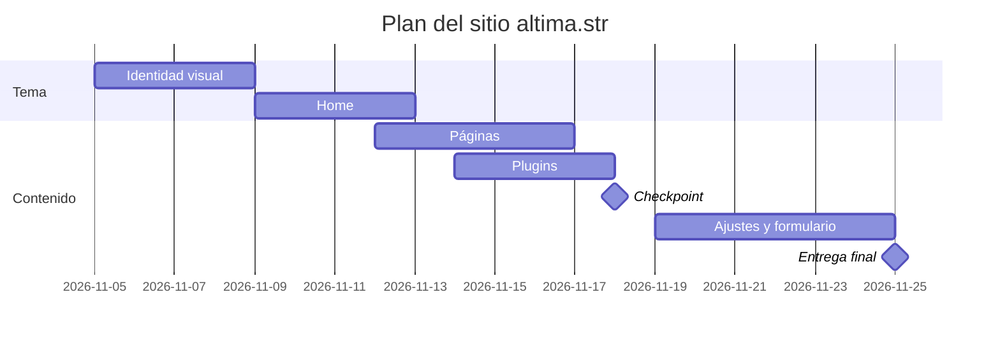

# Decisiones de mi sitio

**Emprendimiento:** altima.str
**Fecha:** 25 de noviembre · **Última corrección:** (se completa en el checkpoint del 18 nov)

## 1. Plugins (10 pts)

Elegí los plugins a partir de `docs/03-funcionalidades.md` y de las integraciones de `docs/04-tecnologias.md`. Datos revisados en WordPress.org el 4 de noviembre de 2026.

| # | Funcionalidad | Plugin | Gratis o de pago | Qué incluye la versión gratis | Probado hasta (WP) | Requiere PHP | ¿Funciona con tema propio? | Enlace a la ficha |
|---|---|---|---|---|---|---|---|---|
| 1 | SEO (obligatorio) | Yoast SEO | Freemium (gratis + Premium) | Análisis SEO y de legibilidad, sitemap XML, URLs canónicas, migas de pan y Schema básico | 7.1.4 | 7.4 o superior | Sí, si el tema incluye `wp_head()` y `title-tag` | [wordpress.org/plugins/wordpress-seo](https://wordpress.org/plugins/wordpress-seo/) |
| 2 | Contacto (obligatorio) | Contact Form 7 | Gratis (código abierto) | Formularios ilimitados, bloque para insertarlos, validación y envío por correo | 7.1.4 | 8.3 o superior | Sí, se inserta con bloque o shortcode en cualquier plantilla | [wordpress.org/plugins/contact-form-7](https://wordpress.org/plugins/contact-form-7/) |
| 3 | Suscripción a novedades y drops | MailPoet | Freemium | Formularios de suscripción y envío de newsletters hasta 1.000 suscriptores | 7.1.4 | 7.4 o superior | Sí, el formulario va por bloque, widget o shortcode | [wordpress.org/plugins/mailpoet](https://wordpress.org/plugins/mailpoet/) |
| 4 | Botón de WhatsApp (consultas de stock, tallas y autenticidad) | Joinchat | Freemium | Botón flotante, mensaje inicial, QR en escritorio y eventos para GA4 | 7.1.4 | 7.0 o superior | Sí, si el tema incluye `wp_footer()` | [wordpress.org/plugins/creame-whatsapp-me](https://wordpress.org/plugins/creame-whatsapp-me/) |
| 5 | Compartir artículos del blog en redes | AddToAny Share Buttons | Gratis | Botones de compartir (Instagram, WhatsApp, X, correo), barra flotante y shortcode | 7.0.8 | 5.6 o superior | Sí, se agrega solo al contenido o con shortcode | [wordpress.org/plugins/add-to-any](https://wordpress.org/plugins/add-to-any/) |

## 2. Páginas de la fase 1 (5 pts)

| # | Página | Por qué la elijo (una línea) |
|---|---|---|
| 1 | Inicio (obligatoria) | Presenta el drop con el hero "Curado pa' la calle" y lleva a la colección o a suscribirse. |
| 2 | Contacto (obligatoria) | Carlos necesita resolver dudas de stock, tallas y envío antes de comprar (formulario + WhatsApp). |
| 3 | Colección | Vitrina de gorras de colección y ediciones especiales, que es lo que diferencia a altima.str; se consulta por WhatsApp, sin carro. |
| 4 | Blog | Atrae público streetwear y conecta artículos con gorras (flujo 2 de `docs/05-arquitectura.md`). |
| 5 | Preguntas frecuentes | Da confianza: autenticidad, guía de tallas, envíos y medios de pago. |

**Páginas que dejo para después:** Tienda con filtros, Ficha de producto, Carrito, Sobre altima.str, Términos y condiciones, Política de privacidad, 404.

## 3. Plan del tema (5 pts)

- **Nombre del tema:** `altima-str`
- **Custom o descargado:** custom, porque ya tengo `DESIGN.md`, la spec de desarrollo y el prototipo de Stitch con la paleta café, rosa y azul marino, y un tema descargado me obligaría a pelear con su estilo.
- **Carta Gantt** del desarrollo del sitio (5 al 25 de noviembre):

| Etapa | Desde | Hasta | Notas |
|---|---|---|---|
| Identidad visual | 5 nov | 8 nov | Tema base (`style.css`, `functions.php`, `header.php`, `footer.php`), variables de `:root` desde `DESIGN.md`, fuentes Alfa Slab One e Inter. |
| Home | 9 nov | 12 nov | `front-page.php`: hero del drop, novedades y bloque de suscripción. |
| Páginas | 12 nov | 16 nov | Colección, Blog (`home.php` + `single.php`), Preguntas frecuentes y Contacto. |
| Plugins | 14 nov | 17 nov | Instalar y configurar los 5 plugins; probar formulario, suscripción y botón de WhatsApp. |
| **Checkpoint (18 nov)** | 18 nov | 18 nov | Revisar este archivo y llenar la tabla de cambios. |
| Ajustes y formulario | 19 nov | 24 nov | Responsive, correcciones del checkpoint, prueba de envío de correos y SEO de cada página. |
| **Entrega final (25 nov)** | 25 nov | 25 nov | Último commit y revisión final. |

## 4. Plan B (5 pts)

| Riesgo | Qué hago | Cuándo se activa (fecha o señal) |
|---|---|---|
| El tema propio no funciona o se rompe | Paso a un tema hijo de un tema liviano (Kadence o Blocksy) y le aplico mis colores y fuentes de `DESIGN.md` con CSS adicional. | Si al 12 nov la Home no se ve completa, o si aparece una pantalla blanca o error crítico que no resuelvo en un día. |
| Un plugin falla o no es compatible | Lo desactivo y lo cambio por su alternativa: Rank Math (SEO), WPForms Lite (contacto), Brevo (newsletter), Click to Chat (WhatsApp), Shared Counts (compartir). | Si un plugin rompe el diseño, da error al activarlo o no funciona con mi tema durante la etapa de plugins (14 al 17 nov). |
| El hosting no tiene PHP 8.3 (Contact Form 7 lo exige) | Subo la versión de PHP desde el panel del hosting; si no se puede, uso WPForms Lite, que pide menos. | Al instalar Contact Form 7 si WordPress avisa que la versión de PHP no es compatible. |
| Los correos del formulario o de MailPoet no llegan | Instalo WP Mail SMTP y lo conecto a una cuenta de Gmail; mientras tanto el botón de WhatsApp queda como contacto principal. | Si un mensaje de prueba no llega a la bandeja en 10 minutos (prueba el 17 nov). |
| No alcanzo a terminar las 5 páginas | Priorizo Inicio y Contacto (obligatorias) y Colección; Blog y Preguntas frecuentes quedan con contenido mínimo y se completan después. | Si al 16 nov hay menos de 3 páginas terminadas. |

## Cambios respecto de la Sumativa 2 (solo en el checkpoint del 18 nov)

| Qué cambié | Qué había antes | Por qué | Evidencia (captura o commit) |
|---|---|---|---|
| | | | |

**Decisión:** (se completa en el checkpoint del 18 nov: continúo con mi propuesta / pivoteo, y por qué)
