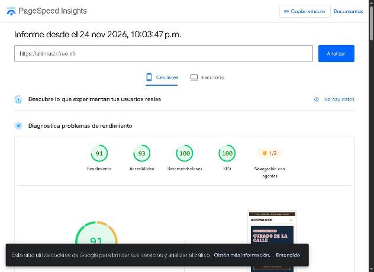
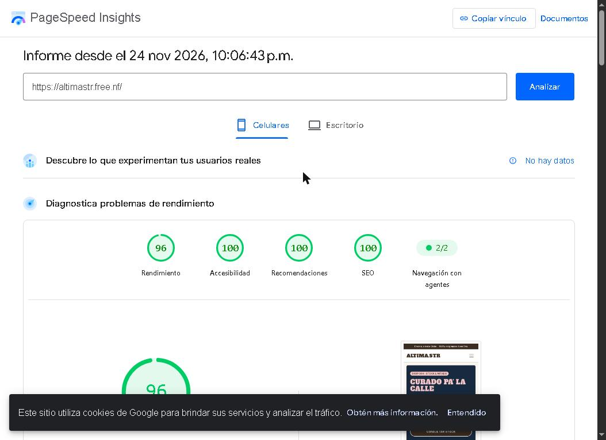

# Análisis de rendimiento con Lighthouse

**Sitio analizado:** [https://altimastr.free.nf/](https://altimastr.free.nf/) (página de inicio)
**Herramienta:** PageSpeed Insights (Lighthouse)
**Dispositivo:** móvil
**Fecha del análisis:** 24 de noviembre de 2026 (dos mediciones: antes y después de aplicar mejoras)

## 1. Resultados (1 pt)

| Categoría | Primera medición (22:03) | Después de las mejoras (22:06) |
|---|---|---|
| Rendimiento | 91 | **96** |
| Accesibilidad | 93 | **100** |
| Buenas prácticas | 100 | **100** |
| SEO | 100 | **100** |

| Métrica (móvil) | Antes | Después |
|---|---|---|
| First Contentful Paint (FCP) | 2,0 s | 1,6 s |
| Largest Contentful Paint (LCP) | 3,2 s | 2,6 s |
| Total Blocking Time (TBT) | 0 ms | 0 ms |
| Cumulative Layout Shift (CLS) | 0,009 | 0,009 |
| Speed Index | 2,9 s | 2,6 s |

**Evidencia:**

- Primera medición: 
- Después de las mejoras: 
- Informe en línea: [PageSpeed Insights de altimastr.free.nf](https://pagespeed.web.dev/analysis/https-altimastr-free-nf/7tr532v30bmj13vj9yu0uu?form_factor=mobile)

## 2. Análisis (1 pt)

- **Qué significan mis puntajes:**
  - **Rendimiento** mide qué tan rápido aparece y se puede usar la página en un celular con conexión 4G lenta simulada. Mira sobre todo cuándo aparece el primer contenido (FCP) y el elemento más grande (LCP, en mi caso el título "Curado pa' la calle" del hero). Partí en 91 y llegué a 96.
  - **Accesibilidad** revisa si personas que usan lector de pantalla o teclado pueden usar el sitio: contraste, textos alternativos, etiquetas y orden de los encabezados. Partí en 93 por dos errores y llegué a 100.
  - **Buenas prácticas** revisa seguridad y calidad técnica (HTTPS, errores en la consola, imágenes con proporción correcta). Saqué 100 desde el inicio.
  - **SEO** revisa si Google puede leer e indexar la página: título, meta descripción, idioma, enlaces con texto y que la página sea apta para celular. Saqué 100 gracias a Yoast SEO (meta descripciones en todas las páginas) y al tema, que usa `title-tag` y un `viewport` correcto.
- **Mi mejor categoría y por qué:** Buenas prácticas y SEO (100 desde el comienzo). El tema propio es liviano (un solo CSS, sin jQuery ni constructores visuales), el sitio carga por HTTPS y cada página tiene título y descripción propios.
- **Mi categoría más débil y por qué:** Rendimiento. Aunque subió a 96, el LCP sigue en 2,6 s porque el hosting gratuito de InfinityFree responde lento (servidor compartido y una verificación de seguridad antes de servir la página) y porque las fuentes de Google se descargan desde otro servidor.
- **Problemas que encontré en el informe:**
  1. **Solicitudes que bloquean el render (ahorro estimado de 1.520 ms):** las fuentes Alfa Slab One e Inter se cargaban con `@import` dentro de `style.css`, así que el navegador tenía que bajar el CSS, leerlo y recién ahí pedir las fuentes.
  2. **Atributo ARIA prohibido:** el botón del menú en celular era un `<label>` con `aria-label="Abrir menú"`, y ese atributo no está permitido en ese elemento.
  3. **Encabezados fuera de orden:** los títulos de columnas del footer eran `<h4>` y en la página aparecían después de un `<h2>`, saltándose el `<h3>`.
  4. **JavaScript sin usar (41 KiB) y caché de recursos:** vienen de los plugins (por ejemplo el de compartir y el de WhatsApp) y de la configuración del hosting gratuito, que no puedo controlar del todo.

## 3. Mejoras (1 pt)

| Mejora | Qué problema resuelve | ¿Aplicada o propuesta? | Resultado (si la aplicaste) |
|---|---|---|---|
| Cargar las fuentes en `header.php` con `preconnect` a fonts.googleapis.com y fonts.gstatic.com, `preload` y carga no bloqueante (`media="print"` que pasa a `all` al cargar), y quitar el `@import` de `style.css` | Solicitudes que bloquean el render | Aplicada (commit "Mejoras Lighthouse") | FCP de 2,0 s a 1,6 s, LCP de 3,2 s a 2,6 s y Rendimiento de 91 a 96 |
| Cambiar el `aria-label` del botón del menú por un texto oculto para lectores de pantalla (`Abrir menú`) | Atributo ARIA prohibido | Aplicada | Accesibilidad de 93 a 100 (junto con la mejora siguiente) |
| Cambiar los `<h4>` del footer por párrafos con estilo (`.footer-titulo`) y usar `<h2>` en los títulos de las tarjetas del blog | Encabezados fuera de orden | Aplicada | Accesibilidad de 93 a 100 |
| Alojar las fuentes en el propio tema (archivos `.woff2` en `assets/fonts/`) en vez de Google Fonts | Elimina la conexión a un servidor externo y el último bloqueo de render (~1.000 ms estimados) | Propuesta (etapa 2) | — |
| Cargar los scripts de AddToAny y Joinchat solo donde se usan (entradas del blog) | JavaScript sin usar (41 KiB) | Propuesta (etapa 2) | — |
| Migrar a un hosting pagado con caché de servidor y HTTP/2 | Tiempo de respuesta lento del servidor gratuito | Propuesta (ver `plan-de-continuidad.md`) | — |

**Tercera medición (22:23), después de reemplazar las ilustraciones por fotos reales de las gorras:** Rendimiento 95, Accesibilidad 100, Buenas prácticas 100 y SEO 100 (FCP 1,7 s y LCP 2,7 s). Las fotos no afectaron el puntaje porque las convertí a WebP de 600 × 600 px (entre 5 y 14 KB cada una), con `width` y `height` declarados para que no muevan el diseño y con carga diferida (`loading="lazy"`) salvo la del hero, que lleva `fetchpriority="high"`. Esta optimización es una tercera mejora aplicada.

> Reconozco los límites del hosting gratuito: InfinityFree comparte servidor entre muchos sitios y agrega una verificación de seguridad antes de servir la página, lo que suma tiempo de respuesta que no depende del tema. Por eso el resultado puede variar unos puntos entre mediciones.
