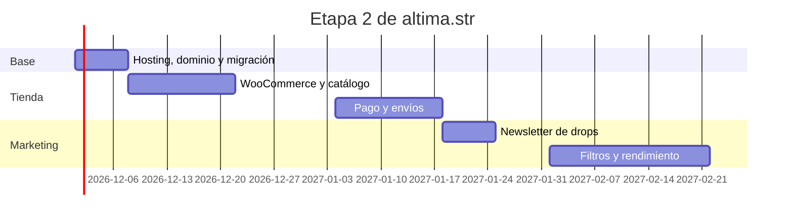

# Plan de continuidad · Etapa 2 de mi sitio

**Emprendimiento:** altima.str
**Sitio de la etapa 1:** [https://altimastr.free.nf](https://altimastr.free.nf)
**Fecha:** 24 de noviembre de 2026

La etapa 1 dejó una vitrina: el visitante ve la colección, lee el blog y consulta por formulario o WhatsApp. La etapa 2 convierte esa vitrina en una tienda donde Carlos (mi proto-persona) pueda comprar desde el celular sin escribir un mensaje.

## 1. Qué quedó fuera de la etapa 1 y por qué (3 pts)

| Funcionalidad | Por qué quedó fuera (tiempo, recursos, costo, conocimientos) | Qué aporta a mi emprendimiento |
|---|---|---|
| Tienda con carro y pago online (WooCommerce + Webpay/Mercado Pago) | **Recursos y costo:** InfinityFree no es apto para cobrar (sin SSL propio garantizado, límites de CPU y sin correo). **Conocimientos:** aún no sé configurar pasarelas de pago ni impuestos. | Venta directa 24/7 sin depender de responder DMs. Es el objetivo principal del brief. |
| Fichas de producto con galería, talla y stock real | **Tiempo:** en la etapa 1 cada gorra tiene una sola foto de catálogo; faltan fotos propias (frontal, lateral, side patch) y la ficha individual depende de WooCommerce. | Que Carlos vea talla, silueta y stock sin preguntar (regla "Do" del DESIGN.md). |
| Newsletter de drops con MailPoet | **Recursos:** InfinityFree gratis no envía correos con PHP, y MailPoet necesita un servicio de envío. Hoy el bloque lleva a Instagram. | Avisar los drops antes que en redes y dar el 10 % de la primera compra. |
| Filtros de tienda (MLB, NBA, colección, talla) y buscador | **Tiempo:** sin catálogo cargado en WooCommerce no hay nada que filtrar. | Encontrar rápido un modelo dentro de un catálogo que va a crecer. |
| Cálculo de envío por región y comuna | **Conocimientos y costo:** requiere integrar un courier (Starken, Chilexpress o Blue Express). | Que el total del carro incluya el envío, como pide el componente `cart-summary`. |
| Dominio propio (altimastr.cl) | **Costo:** el dominio .cl tiene costo anual y no era necesario para la evaluación. | Confianza y una marca más profesional que un subdominio gratis. |

## 2. Recursos que necesito (2 pts)

| Funcionalidad | Plugin o herramienta | Gratis o de pago | Costo aproximado | Qué tendría que aprender |
|---|---|---|---|---|
| Tienda y carro | WooCommerce | Gratis | $0 | Productos variables (tallas), stock, impuestos (IVA), páginas de carro y pago, y plantillas de WooCommerce en mi tema propio. |
| Pago online | Transbank Webpay Plus para WooCommerce o Mercado Pago | Plugin gratis; comisión por venta | Comisión de cerca de 3 % por transacción (según contrato) | Proceso de integración y pruebas en ambiente de integración (sandbox). |
| Envíos | Plugin de courier chileno (por ejemplo Shipit o el de Blue Express) | Freemium | Depende del volumen; desde $0 en plan básico | Tablas de tarifas por región y generación de etiquetas. |
| Newsletter | MailPoet (envío con su servicio) o Brevo | Freemium | $0 hasta ~1.000 suscriptores | Formularios con consentimiento, segmentos y diseño de correos. |
| Fotos de producto | Cámara del celular + remover fondo (Canva o similar) | Gratis | $0 | Fotografía de producto en 1:1 y optimización de imágenes (WebP). |
| Respaldos | BackWPup o el respaldo del hosting | Gratis | $0 | Programar respaldos semanales y guardarlos fuera del servidor. |
| Rendimiento | Caché del hosting + optimización de imágenes (por ejemplo, plugin de conversión a WebP) | Gratis | $0 | Medir con Lighthouse antes y después de cada cambio. |

**Servidor:** para la etapa 2 necesito un hosting pagado con cPanel en Chile o Latinoamérica (por ejemplo HostGator, Hostinger o un plan WordPress administrado), con **PHP 8.3 o superior**, **MySQL/MariaDB**, al menos **10 GB** de espacio (fotos de producto), **certificado SSL** activo (obligatorio para cobrar), **correo saliente** (SMTP propio para pedidos y newsletter) y respaldos automáticos. Costo aproximado: entre $3.000 y $8.000 CLP al mes, más el dominio .cl (cerca de $10.000 CLP al año). El README del repo explica cómo migrar el sitio de InfinityFree a ese servidor.

## 3. Priorización y cronograma (2 pts)

Ordené por impacto en ventas y por dependencia: sin hosting con SSL no hay pagos, y sin WooCommerce no hay fichas ni filtros.

| Prioridad | Qué hago | Cuándo (mes o semana) | Resultado esperado |
|---|---|---|---|
| 1 | Contratar hosting con SSL y dominio altimastr.cl, y migrar el sitio con el procedimiento del README | Diciembre 2026, semana 1 | El sitio actual funcionando en el servidor nuevo, con candado HTTPS y correo propio. |
| 2 | Instalar WooCommerce y cargar el catálogo (10 a 15 gorras con fotos reales, tallas y stock) | Diciembre 2026, semanas 2 y 3 | Colección y fichas de producto con fotos propias, tallas y stock reales. |
| 3 | Pago online (Webpay o Mercado Pago) y envío por región | Enero 2027, semanas 1 y 2 | Primera venta completa en el sitio, con pago y envío calculado. |
| 4 | Newsletter de drops con MailPoet (10 % en la primera compra) | Enero 2027, semana 3 | Lista de suscriptores y primer correo de lanzamiento del Drop 005. |
| 5 | Filtros, buscador y mejoras de rendimiento (imágenes WebP, Lighthouse) | Febrero 2027 | Rendimiento móvil sobre 80 y catálogo fácil de recorrer. |

## 4. Riesgos y mitigación (1 pt)

| Riesgo | Qué haría | Cuándo se activa |
|---|---|---|
| WooCommerce no calza con mi tema propio (fichas y carro se ven sin estilo) | Agrego soporte de WooCommerce al tema y estilizo sus clases con mi CSS; si no alcanzo, uso un tema hijo de Kadence o Blocksy solo para la tienda. | Si al terminar la semana 2 de diciembre la ficha de producto no se ve como el prototipo de Stitch. |
| La comisión o la integración del pago es más difícil o cara de lo previsto | Parto con transferencia bancaria y pago contra confirmación por WhatsApp (sin pasarela) y comparo Webpay con Mercado Pago. | Si la integración de pruebas no funciona en una semana o la comisión supera el 4 %. |
| La migración desde InfinityFree falla (URLs, imágenes o tamaño del respaldo) | Sigo el plan del README: respaldo con el plugin de migración; si el archivo supera el límite, migro por FTP + phpMyAdmin y corrijo URLs con un buscar y reemplazar. | Si al importar el sitio no abre, faltan imágenes o el plugin rechaza el archivo. |
| Las fotos de producto quedan pesadas y el sitio se pone lento | Convierto a WebP, uso tamaños de 800 px y carga diferida; mido con Lighthouse antes y después. | Si el rendimiento móvil en Lighthouse baja de 60. |
| Me falta tiempo por trabajo y estudios | Priorizo solo hasta la fila 3 (vender online); newsletter y filtros pueden esperar. | Si a mitad de enero no está listo el pago online. |
